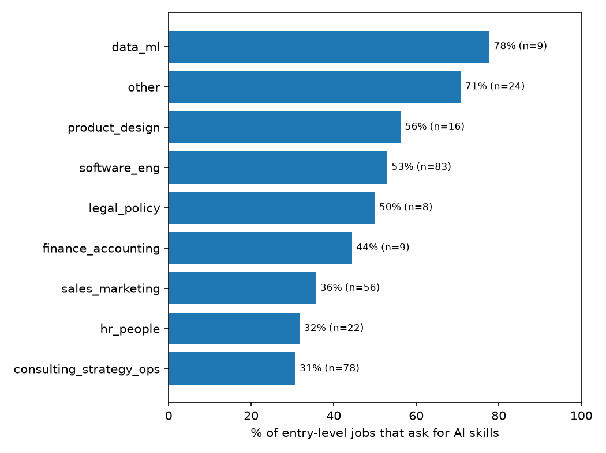

# Is AI eating entry-level jobs?

A weekly tracker of job postings at 44 tech companies. It measures how many openings are entry-level and how many entry-level postings ask candidates for AI skills.

Latest snapshot: November 4, 2026. 9,064 open jobs, 304 of them explicitly entry-level.

## Findings

**Only 3% of open jobs were explicitly entry-level** (304 of 9,064). I counted a job as entry-level when its title says so (new grad, junior, associate, level I) or when the posting asks for at most one year of experience. Jobs that are open to new graduates but don't say so are not counted, so the real share is probably somewhat higher. Data and machine learning had the fewest entry-level openings: 9 of 885 (1%).

**45% of entry-level postings ask for AI skills.** The share is 43% after removing jobs with AI in the title, so the requirement shows up across ordinary roles.

**Software roles ask most often.** 53% of entry-level software postings ask for AI skills, compared with 31% in strategy and operations. The difference is statistically significant (two-proportion z ≈ 2.9).

**Most AI requirements are about using AI tools.** Software postings ask candidates to use tools such as ChatGPT or Copilot (27%) more often than to build AI systems (17%). In sales and marketing the split is 25% to 7%.

| Function | Entry-level jobs | Ask for AI skills | Use AI tools | Build AI |
|---|---|---|---|---|
| Software engineering | 83 | 53% | 27% | 17% |
| Strategy and operations | 78 | 31% | 9% | 4% |
| Sales and marketing | 56 | 36% | 25% | 7% |

The table shows only functions with at least 30 entry-level jobs. Postings that mention AI without saying whether the candidate uses it or builds it count toward "Ask for AI skills" but neither of the last two columns.

## How it works

1. Every Monday, a GitHub Actions job pulls every open posting from each company's public Greenhouse, Lever, or Ashby job-board API.
2. A job posted in several cities counts once.
3. Rules in `classify.py` label each job's level, its function, and whether it asks for AI skills. The AI rules ignore benefits sections, "About us" sections, and sentences written in the company's voice, so a company describing its own AI products does not count as a requirement.
4. Entry-level jobs and internships are stored with their text. All other jobs are counted by function and level.
5. `analyze.py` writes the tables and charts in `results/`.

## Validation

I checked the rules against my own labels. I read and labeled each posting without seeing the rules' answers. Each sample was half postings the rules said ask for AI skills and half they said do not, and the AI accuracy is weighted back to the real mix of postings.

The first round of 80 postings showed that the level rules counted jobs asking for two or more years of experience as entry-level. Level accuracy was 54%. I set the cutoff at one year to match my labels, then labeled 40 new postings that the rules had never been adjusted on.

| Holdout (40 postings) | Result |
|---|---|
| AI skill, weighted accuracy | 88% |
| AI skill, precision | 80% |
| AI skill, agreement when the rules say no | 95% |
| Level | 92% |
| Function | 90% |

The 80% precision means the rules overcount AI requirements. After correcting for that, the software and strategy-and-operations rates are roughly 45% and 28%, so the gap remains.

## Limitations

- The tracker measures what postings ask for. It does not show that AI replaced any worker.
- It covers companies that post jobs on Greenhouse, Lever, or Ashby, which are mostly tech companies. Big 4 firms and most banks use Workday, which has no public API.
- Level accuracy shows how often jobs labeled entry-level really are entry-level. It cannot measure entry-level jobs the rules missed.
- The holdout has 40 postings, so each accuracy figure could be off by 10 percentage points or more in either direction.
- Known misses: notices about how a company uses AI in hiring, marketing copy addressed to the reader, and product names the word lists don't know.
- So far there is one snapshot. A weekly trend will be added after about six runs.

## Repository

| File | Purpose |
|---|---|
| `companies.csv` | Companies tracked and their job-board IDs |
| `sources.py` | Calls the Greenhouse, Lever, and Ashby APIs |
| `classify.py` | Level, function, and AI-skill rules |
| `collect.py` | Takes one weekly snapshot |
| `label.py` | Builds the blind labeling sample and scores it |
| `analyze.py` | Writes the results tables and charts |
| `tests/` | Tests for the rules |
| `results/` | Latest findings and validation report |

Raw posting text is not included because it belongs to the employers. `SETUP.md` explains how to run the tracker on your own list of companies.

Brandon C · [LinkedIn](https://www.linkedin.com/in/brrandon/)
