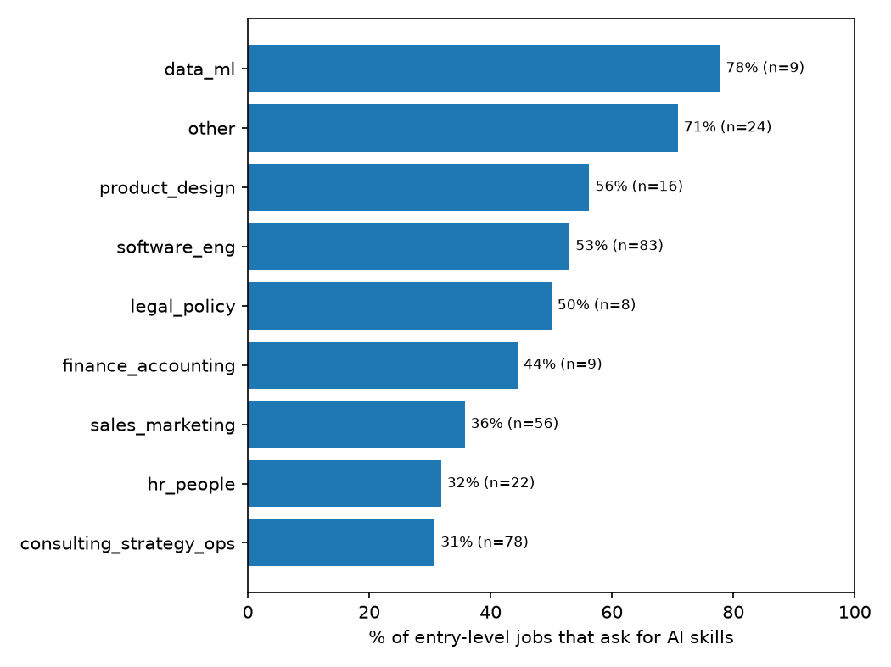

# Results (305 entry-level jobs from 35 companies)

## Entry-level jobs that ask for AI skills
Overall: **45%** of entry-level jobs ask for AI skills (43% when AI-titled roles are excluded).

| function | jobs | ask_for_ai | ask_for_ai_excl_ai_titled | use_ai_tools | build_ai | mention_ai_anywhere | note |
|---|---|---|---|---|---|---|---|
| software_eng | 83 | 53% | 52% | 27% | 17% | 67% |  |
| consulting_strategy_ops | 78 | 31% | 31% | 9% | 4% | 50% |  |
| sales_marketing | 56 | 36% | 36% | 25% | 7% | 68% |  |
| other | 24 | 71% | 71% | 62% | 0% | 83% | small sample |
| hr_people | 22 | 32% | 32% | 18% | 5% | 64% | small sample |
| product_design | 16 | 56% | 56% | 12% | 25% | 62% | small sample |
| data_ml | 9 | 78% | 67% | 11% | 56% | 78% | small sample |
| finance_accounting | 9 | 44% | 44% | 22% | 22% | 89% | small sample |
| legal_policy | 8 | 50% | 43% | 12% | 0% | 100% | small sample |

ask_for_ai = the posting asks the candidate to have or use AI skills. use_ai_tools / build_ai split that by kind. mention_ai_anywhere includes company boilerplate.

## Entry-level share of all openings (2026-11-04)
Overall: **3%** of open jobs are entry-level.

| function | all_jobs | entry | entry_share |
|---|---|---|---|
| sales_marketing | 2617 | 55 | 2% |
| software_eng | 2510 | 83 | 3% |
| consulting_strategy_ops | 988 | 78 | 8% |
| data_ml | 885 | 9 | 1% |
| product_design | 491 | 16 | 3% |
| finance_accounting | 477 | 9 | 2% |
| other | 455 | 24 | 5% |
| legal_policy | 301 | 8 | 3% |
| hr_people | 289 | 22 | 8% |
| hardware_eng | 51 | 0 | 0% |

